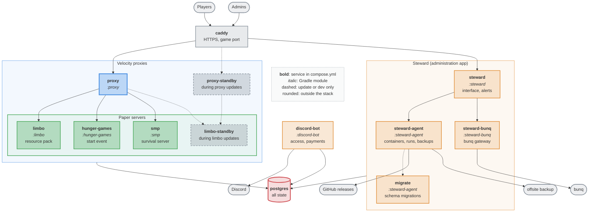

# season-2

Code and deployment of nordtal.eu season 2: four Minecraft plugins, a Discord bot, three Steward
services and the resource pack. One Gradle build, versioned in `gradle.properties`, deployed as one
`docker compose` stack. [`CONVENTIONS.md`](CONVENTIONS.md) contains the rules for every change.

## Overview

A Velocity proxy forwards players to three Paper servers. Every player joins `limbo` first,
receives the resource pack and is then moved to the server set by the current season phase. Access,
language, phase and event state are stored in one PostgreSQL database; Discord roles are derived
from it. Steward is the admin web interface and runs every update, restart and backup.

## Architecture



`compose.yml` is part of the `steward-agent` image. The libraries listed below are compiled into the
jars of the services.

- **Networks:** the Minecraft servers share no network with Steward. `steward-agent` and
  `steward-bunq` each share an internal network with `steward` only.
- **Docker:** `steward` is reachable from the internet and has no Docker socket. `steward-agent` has
  the socket and executes every run requested by a row in `steward_inbox`.
- **Bank key:** only `steward-bunq` holds the bunq API key. It makes no decisions.
- **Standby services:** `proxy-standby` and `limbo-standby` take over while an update replaces
  `proxy` or `limbo`. Caddy routes port 25565 to the active proxy.
- **Commands:** each plugin registers Brigadier commands. Admins enter them on the server console;
  Steward sends a typed request to the server's inbox, which runs the same action.
- **Text:** player-facing text is German or English, loaded once per join off the main thread.
- **Glyphs:** glyphs are allocated in [`resource-pack/glyphs.json`](resource-pack/glyphs.json). The build
  generates the fonts, `Glyphs` and the advance tables from it.

### Modules

| module              | platform        | contents                                                                                  |
| ------------------- | --------------- | ----------------------------------------------------------------------------------------- |
| `proxy`             | Velocity        | Login check, season phase, backend selection.                                             |
| `limbo`             | Paper           | Holding server that applies the resource pack.                                            |
| `hunger-games`      | Paper           | Start event: teams registered via the bot, border, loot, HUD, winner.                     |
| `smp`               | Paper           | Nordtal, farm world, Nether, End, milestones, aura, prestige, wheel, duels, graves.       |
| `discord-bot`       | JVM app         | Access sales and grants, linking, roles, game registration, admin log. Books no payments. |
| `steward`           | JVM app + React | Web interface and API; books payments, sends alerts, schedules runs.                      |
| `steward-agent`     | JVM app         | Schema, jar versions, all runs. The only service that creates containers.                 |
| `steward-bunq`      | JVM app         | Holds the bunq API key; creates and cancels tabs, lists payments. Makes no decisions.     |
| `common`            | library         | Platform constants, phase enum, languages, readiness. Depends only on the JDK and Gson.   |
| `database`          | library         | All PostgreSQL access: access, phase, payments, inboxes, signal hub, migration SQL.       |
| `messages`          | library         | Message system without Adventure, used by the bot and Steward.                            |
| `message-rendering` | library         | Messages as Adventure components, for Paper, Velocity and Steward's menu previews.        |
| `discord-rendering` | library         | Documents and messages as Discord components, for the bot and Steward's previews.         |
| `pack-rendering`    | library         | Glyph constants, the `<glyph:name>` tag, boss bar and tab list.                           |
| `limbo-protocol`    | library         | Protocol between the proxy and limbo.                                                     |
| `internal-api`      | library         | Token-authenticated HTTP between `steward`, `steward-agent` and `steward-bunq`.           |
| `paper-common`      | library         | Code shared by the Paper plugins.                                                         |
| `display-tags`      | library         | Name tags as packet-only text displays, started by smp.                                   |
| `settings`          | library         | Loading of every process's settings.                                                      |
| `spec`              | library         | Settings groups as spec interfaces, and the schema of Steward's forms.                    |
| `resource-pack`     | assets          | The pack, its glyph allocation, and the zip + SHA-1 of a release.                         |
| `bridge-mod`        | Fabric mod      | Client mod through which the Nordtal Designer reloads the pack and shows previews.        |
| `designer`          | Aseprite plugin | The Nordtal tab of Nordtal Designer: pack tree, embedded editor and properties.           |
| `architecture`      | tests           | ArchUnit rules over every module: dependencies and wiring.                                |
| `shipped-jars`      | tests           | Loads each shipped jar the way its host does.                                             |

## Operation

Run this on a host with Docker, in the directory that holds the installation:

```bash
curl -fsSL https://raw.githubusercontent.com/nordtal/season-2/main/deploy/nordtal.sh | bash
```

Worlds, database, plugin configuration and backups are stored in folders of that directory. Secrets
are stored in `/etc/nordtal/season-2.env` (mode 600); a secret used by a single service is stored in
that service's file under `/etc/nordtal-secrets/season-2/`. The script remains as `./nordtal.sh`:

```bash
./nordtal.sh                 # the menu: what is set, change one, then deploy
./nordtal.sh update          # update the whole network and wait for the run to end
./nordtal.sh update --backup # one backup run
```

[`deploy/README.md`](deploy/README.md) covers first deployment, updates, backups, restore, firewall
and troubleshooting.

## Development

The build runs on JDK 25 from Eclipse Temurin, as `gradle/gradle-daemon-jvm.properties` asks; Gradle downloads it when the machine has none. Build only the modules you changed.

```bash
./gradlew :smp:check                 # one module, with its tests and the convention checks
./gradlew releaseArtifacts           # exactly what a release ships
./gradlew :hunger-games:runServer    # a local Paper test server
./gradlew -q :dev:run --args="init"  # then --args="up": runs the network locally
```

`dev deploy smp` rebuilds one module and restarts its container. `dev` is a Java program in `:dev`,
run from IntelliJ's _dev: stack_ folder or as `./gradlew -q :dev:run --args="<command>"`; it needs Java
and Docker on any operating system. [`deploy/README.md`](deploy/README.md#locally) lists the commands.

A release is a pushed tag on a commit of `main` whose `build` run is green:

```bash
git tag v0.1.0 && git push origin v0.1.0
```

The `release` workflow refuses a tag whose commit has no successful build on `main` or that is already
a release, and checks it against `gradle.properties`. It pushes every image tagged with the version
alone and publishes the GitHub release last, with the four plugin jars and the pack, so a failed run
publishes nothing. To rerun it: `gh workflow run release.yml -f tag=v0.1.0`.

Every config file is commented YAML described by a `@ConfigSpec` interface. Credentials are passed
as environment variables; this public repository contains none. The only outbound call that sends
player data to a third party: Steward loads player heads from [mineatar](https://mineatar.io) and
sends it the `mc_uuid` (group `web`, setting `avatars.minecraft-head-base-url`; empty disables it).
