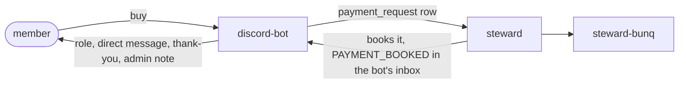
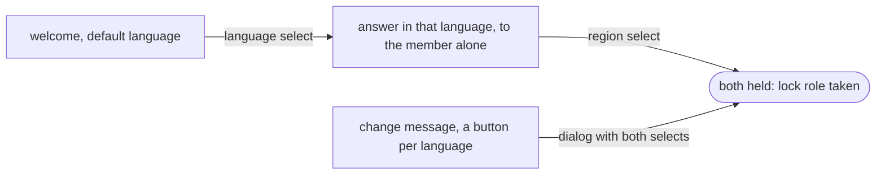

# discord-bot

The season 2 Discord bot: access purchases and grants, account linking, roles, the Hunger Games
registration, status channels and the admin log. It talks to PostgreSQL and the Discord gateway and to
nothing else, so it runs without any Minecraft server.



The bot holds no bunq key and books nothing. The prices are the network's `prices` group. The bot never
migrates: at startup Flyway's `validate()` refuses a database the bot was not built against, and
compose starts the bot only after the `migrate` service has succeeded. `PREVIEW_MESSAGE` sends an
admin a direct message with the previewed text. A closed direct message refuses the request
(`NOT_DELIVERED`).

## Requirements

- A Discord application with the `GUILD_MEMBERS` privileged intent.
- The guild id, which `deploy/nordtal.sh` asks for.
- The permission to manage roles and channels.

Every channel is an id set in Steward. An empty id switches its feature off. The bot publishes the
guild's channels into `guild_channels` at start and on every change, and Steward's channel pickers read
that table.

The languages are the network's (`language-and-time.languages`). The `access` group's `languages` holds
one entry per tag with its role name and channels, and no other entry. The bot refuses a list that differs.

Steward edits the `access` and `onboarding` groups. `compose.yml` passes the bot only the database,
`NORDTAL_ACCESS_GUILD_ID` and Steward's address `NORDTAL_BOT_STEWARD_URL`. Each of them wins over the
stored value, and the startup log lists every setting the environment overrode. The token
`NORDTAL_BOT_TOKEN` is in the bot's own `secrets.env`, which compose mounts into the bot alone (see
[../deploy/README.md](../deploy/README.md)).

```bash
COMPOSE_PROFILES=db,bot docker compose --env-file /etc/nordtal/season-2.env up -d
./gradlew :discord-bot:imageContext && COMPOSE_PROFILES=db,bot docker compose up -d --build   # a local image
```

## Where things live

- `access/`: purchases, grants, linking, the reaction to a booked payment and the managed messages.
- `registration/`: team registration for a game, named by its key. The Hunger Games is the only game.
- `onboarding/`: the language and region roles, the lock and the onboarding messages.
- `roles/`: every role the bot uses (`GuildRoles`).
- `announce/`, `discord/`: announcements, admin commands and the update feed.
- `DocumentRenderer`: draws a document (`src/main/resources/documents/discord/`) as a Components V2
  message, a modal, a plain message or a channel name within Discord's limits. Everything the bot posts
  is one. If an admin wrote a document in Steward (`StoredDocuments`, re-read on `nordtal_messages`), the
  next publish draws it. `DocumentMerge` adapts it when a release changed the packaged document.
- `config/`: the config specs (`bot`, `access`, `onboarding`) and their defaults.
- `src/main/resources/documents/`: the documents with their translations.

## Roles

Steward holds a name for every role the bot uses. The bot takes the role of exactly that name or creates
it, stores its id in `discord_role` and follows the id, so an admin may rename the role. The bot looks by
name again only after the role is deleted. If two roles have the name, the bot takes neither and tells the
admin channel.

## Onboarding

A member's language and region are Discord roles, and the roles are the source. The bot copies every change
into `discord_user.locale` and `time_zone`. A member without a role gets the network's value. If a member
holds two roles of a kind, the bot keeps the one added last. Both channels are ids in Steward's `onboarding`
group.



- The onboarding channel holds the welcome. The bot answers a chosen language with a select of the regions,
  unless the member holds a region already.
- The change channel holds a button per language. Each button opens a dialog with both selects.
- The lock role sees only the onboarding channel. The bot keeps its overwrite on every channel and repairs
  drift on every reconcile.
- With the lock on in Steward, the bot gives the lock role to a member who misses either role, and never to
  a bot. A member loses it as soon as both roles are held. Switching the lock off takes the role from
  everyone once. A role given by hand after that stays.
- The bot withholds the access and donor roles while the lock role is held. When the lock goes, both return
  as the database has them. The game is unaffected, since the proxy reads the database.

## Registration

The bot owns `registration`, `team` and `team_member`. Each round is named by its game's key from `Game` in
`:database`. A second team mode needs a constant there and its own Register message. The game server
creates a game from the round when it starts and is the only one that changes the round's state. A closed
round refuses every change. It opens again with its teams when its game is aborted. It ends when its game
is decided, and the next registration opens a new round.

## Texts

The bot renders every text it sends from a message of its bundle with `DiscordRenderer`, the Discord target
of `:messages`. `:architecture` refuses `Messages.format` in this module.

- JDA's sanitizer escapes each value in a markdown text. A link stays as it is. A text shown without markdown
  (a button, select, modal or channel name) is declared `PLAIN`.
- The admin channel reads the admin bundle, `messages/admin` of `:database`, which Steward's page renders
  too. `AdminLog.record` writes a journal line, and the card is the same message rendered here, so the
  journal and the card cannot differ. Steward writes a booking's line with the booking, and it reaches the
  bot in the request it reacts to. A mention in a card names someone without a ping. Only an alert's admins
  are pinged.
- The bot's own bundle holds only what a member reads, in every language. A server or Steward writes an
  announcement as messages of `:database`'s bundle, and the bot renders it in each channel's language.
