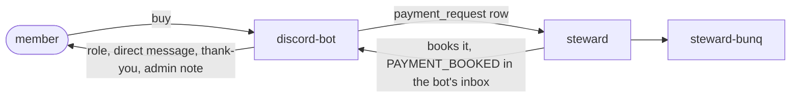

# discord-bot

The season 2 Discord bot: access purchases and grants, account linking, roles, the Hunger Games
registration, status channels and the admin log. It talks to PostgreSQL and the Discord gateway and to
nothing else, so it runs without any Minecraft server.



The bot holds no bunq key and books nothing. The prices are the network's `prices` group. The bot never
migrates: at startup Flyway's `validate()` refuses a database the bot was not built against, and
compose starts the bot only after the `migrate` service has succeeded. `PREVIEW_MESSAGE` sends an
admin a direct message with the previewed text. A closed direct message refuses the request
(`NOT_DELIVERED`).

## Requirements

- A Discord application with the `GUILD_MEMBERS` privileged intent.
- The guild id, which `deploy/nordtal.sh` asks for.
- The permission to manage roles and channels.

Every channel is an id set in Steward. An empty id switches its feature off. The bot publishes the
guild's channels into `guild_channels` at start and on every change, and Steward's channel pickers read
that table.

The languages are the network's (`language-and-time.languages`). The `access` group's `languages` holds
one entry per tag with its role name and channels, and no other entry. The bot refuses a list that differs.

Steward edits the `access` and `onboarding` groups. `compose.yml` passes the bot only the database,
`NORDTAL_ACCESS_GUILD_ID` and Steward's address `NORDTAL_BOT_STEWARD_URL`. Each of them wins over the
stored value, and the startup log lists every setting the environment overrode. The token
`NORDTAL_BOT_TOKEN` is in the bot's own `secrets.env`, which compose mounts into the bot alone (see
[../deploy/README.md](../deploy/README.md)).

```bash
COMPOSE_PROFILES=db,bot docker compose --env-file /etc/nordtal/season-2.env up -d
./gradlew :discord-bot:imageContext && COMPOSE_PROFILES=db,bot docker compose up -d --build   # a local image
```

## Where things live

- `access/`: purchases, grants, linking, the reaction to a booked payment and the managed messages.
- `registration/`: team registration for a game, named by its key. The Hunger Games is the only game.
- `onboarding/`: the country and language roles, the lock and the start-channel message.
- `roles/`: every role the bot uses (`GuildRoles`).
- `announce/`, `discord/`: announcements, admin commands and the update feed.
- `StoredDocuments`: the documents (`src/main/resources/documents/discord/`) that `DocumentRenderer` of
  [`discord-rendering`](../discord-rendering/README.md) draws. Everything the bot posts is one. If an
  admin wrote a document in Steward (re-read on `nordtal_messages`), the bot edits its managed
  messages at once.
  `DocumentMerge` adapts it when a release changed the packaged document.
- `config/`: the config specs (`bot`, `access`, `onboarding`) and their defaults.
- `src/main/resources/documents/`: the documents with their translations.

## Roles

Steward holds a name for every role the bot uses. The bot takes the role of exactly that name or creates
it, stores its id in `discord_role` and follows the id, so an admin may rename the role. The bot looks by
name again only after the role is deleted. If two roles have the name, the bot takes neither and tells the
admin channel.

## Onboarding

A member chooses a country in the start channel. Its role supplies the country and time zone in
`discord_user`. A country supplies the language role only while the member has none. A later country
change keeps that language. The member's settings reply shows language and time zone, links to that
language's rules and offers the other languages.

Lock on gives the lock role to members without a country. Lock off removes it. The bot preserves the
start channel's `@everyone` overwrites and keeps the lock role's access. The bot denies View Channel
on every other channel to the lock role and on each language's category and channels to the other
languages. A changed category removes its former denials. The sweep reports explicit allows that
expose a channel to protected members.

## Registration

The bot owns `registration`, `team` and `team_member`. Each round is named by its game's key from `Game` in
`:database`. A second team mode needs a constant there and its own Register message. The game server
creates a game from the round when it starts and is the only one that changes the round's state. A closed
round refuses every change. It opens again with its teams when its game is aborted. It ends when its game
is decided, and the next registration opens a new round.

## Texts

The bot renders every text it sends from a message of its bundle with `DiscordRenderer`, the Discord target
of `:messages`. `:architecture` refuses `Messages.format` in this module.

- JDA's sanitizer escapes each value in a markdown text. A link stays as it is. A text shown without markdown
  (a button, select, modal or channel name) is declared `PLAIN`.
- The admin channel reads the admin bundle, `messages/admin` of `:database`, which Steward's page renders
  too. `AdminLog.record` writes a journal line, and the card is the same message rendered here, so the
  journal and the card cannot differ. Steward writes a booking's line with the booking, and it reaches the
  bot in the request it reacts to. A mention in a card names someone without a ping. Only an alert pings,
  and it pings the admin role. The alert of a failed run takes the place of the run's card, or answers it
  when that card cannot be deleted.
- The bot's own bundle holds only what a member reads, in every language. A server or Steward writes an
  announcement as a row per language with the admin's words or the milestone's name, and the bot renders it
  from `:database`'s bundle in each channel's language and answers on the same row whether it was posted.
