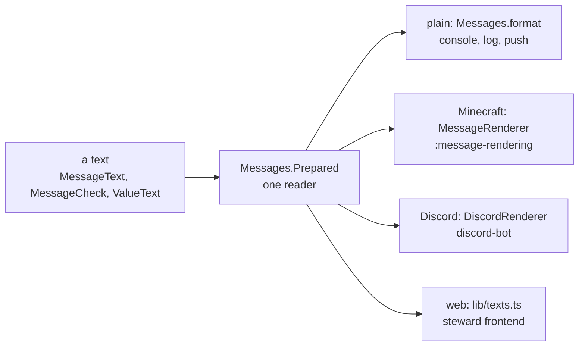

# messages

The `messages` module loads message bundles without Adventure, so the bot and Steward can use it.
`Messages` holds the bundles and the admins' overrides, `MessageRef` names a message with its values,
`spec` declares every key and `context` declares the contexts a message can name. `Refusal` and
`Refused` model a refusal for an inbox, a command and an HTTP answer. A process passes its
`MessageEnvironment` (service, season) to its bundles at startup with `Messages.within`.

`MessageText` parses every text, `MessageCheck` validates it and `ValueText` formats its values for
every target. The browser walks the tree of `MessageText` and formats values as `ValueText` does.
The shared vectors hold both to the same result.

## Writing a text

A value is `{role}` or `{role.attr}`, optionally with a kind and a style: `{left, duration, short}`.
`{n, plural, one {# day} other {# days}}` and `{open, select, true {open} other {closed}}` are the
only MessageFormat syntax a text may use. The kinds are a closed set:

| kind       | styles (the first is the default)                                                               |
| ---------- | ----------------------------------------------------------------------------------------------- |
| `text`     |                                                                                                 |
| `number`   | grouped, `plain`, at most two fraction digits                                                   |
| `duration` | `long` (its two largest units), `short` (`2h 5m`), `clock` (`2:05:00`), `minutes` (`1d 6h 30m`) |
| `instant`  | `datetime`, `date`, `time`, `relative`, in the reader's zone                                    |
| `money`    | in the reader's language: `€3.00`, `3,00 €`                                                     |
| `list`     | `and`, `or`                                                                                     |
| `name`     | with the process's name card, `plain` without                                                   |
| `mention`  |                                                                                                 |
| `item`     |                                                                                                 |
| `glyph`    |                                                                                                 |
| `choice`   | what `select` chooses on; an enum constant reads in kebab case                                  |
| `message`  | another message, rendered for the same reader in the same target                                |

A Minecraft text is MiniMessage. A packaged text colours only with the tones of `Tone`, such as
`<good>`. The `colours` group of each process maps the tones to hex. An admin's override may also
name colours and gradients. A value may appear in a hover text and, quoted, in a click's target, and
in no other tag argument. `<glyph:name>` draws a glyph of the pack. `<action:name>…</action>` is a
click whose command the code binds.

### Building blocks

A building block is a text of the block bundles (`Messages.BLOCKS`: `values` and `terms`) that
other texts name instead of copying it: `{@values.duration.days, n=days} left`. Each renderer fills
it at its place for the same reader, so an admin's override of the block reaches every text that
names it. `n=days` binds the block's value `n` to the outer value `days`; a binding of a context role
also binds its attributes. A value left unbound takes the outer value of the same name. A block may
name another block. A cycle, or a key that is no block, shows the replacement word of `text`.

The check refuses a key that is no block, a binding of a value the block does not declare, a value
the block needs and the text does not offer, a value of another kind, and a block in a tag argument.
Its declarations come from the block specs (`Messages.BLOCK_SPECS`).
`MessageCheck` and `DocumentCheck` measure a text with the blocks they are given, the packaged
English ones by default, so Steward checks a document with an admin's blocks.

## Values and contexts

A message declares its values in its spec with `@Arg`, and the Java type of a value gives its kind.
A context (`MessageContext`) is a record annotated `@ContextType` in the module that owns it, and
`Contexts` is the registry. Every message also has the roles `server`, `season`, `network` and
`viewer`, and every player role has `self`.

- An instant shows in the reader's zone, else in the network's. In Discord it is Discord's own
  timestamp, and `relative` is the countdown that Discord keeps current.
- A missing value shows the replacement word of its kind from the `values` bundle (`someone`,
  `jemand`) and logs a warning. `{x}` is never printed. The build refuses a spec parameter without a
  kind.
- `GameContent` is a translatable component that the client reads in its language. Other targets
  show English.
- A `message` value is a phrase written once and placed in many texts. It is never rendered into a
  string ahead of time, because only the target knows the reader's language and how to draw the
  tones. `@Takes` names the keys it may take: `key`, `bundle/key`, or `bundle/*` for any key of that
  bundle, which needs an `@Example`. Without an `@Example`, the first key is previewed.

## A message as data

`MessageJson` writes a message as `{"key", "args"}` with each value as `{"kind", "value"}`. A row
that stores a message stores this form, and a target renders it when somebody reads it.

The browser reads message syntax only in Steward's translation editor (`lib/message-tree.ts`), which
follows `MessageText` line by line. It walks the `NodeJson` trees of `MessageJson.texts`.
`WebTargetVectorsTest`, `message-tree.test.ts` and `texts.test.ts` hold both sides to the vectors in
`src/test/resources/web-target.json`.

## Where a text is shown

`@Shown` names every place where a key appears (`Display`). It sits on the spec, a section or the
key, and the nearest one wins. A place has a surface (`Display.Surface`: the game, Discord or
Steward). The surface groups the key on Steward's Translations page and decides how Steward previews
the place. The length limit of a key is the strictest limit of its places (`Display.strictest`).

## Discord documents

Everything the bot posts is a document (`document`): one JSON file
`documents/<namespace>/<name>.json` in the resources of the module whose code fills it. The file holds
the tree of Components V2 parts and every text in every language. The code declares the document once
as a `static final` `DocumentSpec` and names its class in the build with
`messageSpec { documentClasses.add(...) }`. The declaration holds only:

- the name in kebab case, the namespace and the area Steward lists it under;
- the shape: a message, a modal, a plain message content or a channel name;
- the values its texts may name, the components of a record, each with an `@Example` and, for a value
  that is a text of a bundle, the keys it `@Takes`;
- the slots the code fills (`Slot`): a button, a select, a field, a data list or a block per
  language, each required or optional.

A text is `{"en": "...", "de": "..."}`. A language that maps to a list shows one of its versions at
random. A part, a line or a row item with `when` shows only if its value holds: `value`, `!value` or
`value=constant` (`Condition`). That replaces the code's choice between layouts. A data list's line
and a select's option line may also name the values of each item.

The `messageSchema` task checks each file against its declaration and writes
`documents/<namespace>/declarations.json`. `DocumentCheck` refuses a file that:

- places a slot wrongly or leaves out a required one;
- names a value it does not declare;
- lacks an English text, or a language that the document's other texts have;
- breaks the Components V2 limits, which are JDA's constants. `DocumentRendererTest` in discord-bot
  compares the two;
- breaks the Wording and terms rules of `MessageCheck`.

steward-agent ships the declarations and documents with the bundle (`MessageBundle.documents`).
`Documents.Packaged.hash` is the SHA-256 of a packaged declaration and document.

An admin's document replaces the packaged one whole. It may move the slots, leave out the optional
ones, change every text and add link buttons and images. An image is `attachment://`, `https://` or
`upload://<id>`, which is an image that an admin uploaded in Steward and that the bot sends as an
attachment. A file part holds one such image that the message packs, never an `https://` one.
`DocumentStore` keeps the document with the packaged hash it was written over, and the bot reads it
again on `nordtal_messages`. Steward's Translations page edits it.

`DocumentMerge` keeps an admin's document when a release changes the packaged one:

- A slot that the release removed, or gave another type, is taken out.
- A required slot that the release added is placed at the end, as the release places it.
- A document that still does not fit is set aside for the packaged one.

Every change is an `Adaptation`, which Steward lists.

## The check

The `messageSchema` task of the build runs `MessageSpecCheck`, which holds every spec against its
bundles in the packaged mode. Steward runs the same `MessageCheck` on an admin's override, where an
error of a release is a warning. Each problem is a message of the English-only `check` bundle
(`CheckMessages`), so an admin can read and change it in the editor. The build and a log show it in
the packaged English (`MessageCheck.english`). `GET /api/message-check` returns the problems of a
text for a key.

- The check refuses an undeclared value, an unknown tag, a colour in a packaged text and a text that
  is longer than the strictest limit of its places.
- It refuses a word that `TermMessages.SYNONYMS` lists for a game term.
- The build refuses a key that is shown nowhere.
- A text that never shows a value it is given is an error in a bundle and a warning in an override.
  So is a line break in a text that is shown only where the game draws one line (`Display.oneLine`),
  and so is a link whose visible text is its own address.

## Packaged texts and overrides

`PackagedTexts` reads a bundle from `messages/<bundle>/<language>.properties` in the jar. A key may
hold several texts, and one is chosen at random each time: `key=`, then `key[1]=`, `key[2]=` without
a gap.

An admin's change is rows of `message_override`, one per bundle, key, language and variant. Steward
writes them. Every process reads them at start and on the signal hub's `nordtal_messages`. A Paper
plugin reads them off the main thread and shows the packaged texts until the hub has connected.

- The texts of an override replace the packaged texts of that language as a set. The override keeps
  the packaged texts it replaced, and every process compares their hash with its jar.
- A process sets an override aside when its hash no longer matches the jar or the validator refuses
  it. The hash no longer matches when the admin wrote the override over a text that this release
  changed. The packaged text shows until an admin saves the override again. Every process logs the
  override, and Steward lists them at `GET /api/message-fallbacks`.
- `@Formerly` names the former names of a renamed key (`key` or `bundle/key`), and the schema copies
  them into the jar. An override under a former name follows the key. An override under the current
  name wins.
