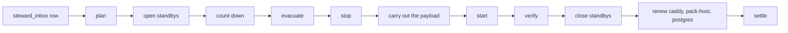

# steward-agent

`steward-agent` holds the Docker socket and the volumes, and carries out every run. It carries
`compose.yml` in its own image. The same image is the `migrate` service, the only process that runs
Flyway's `migrate`: it creates every role, applies the schema and exits. Every service with a database
login waits for it.

`steward` mounts no socket and reaches the agent through `:internal-api`'s `AgentClient`.
`:architecture` refuses `java.net.UnixDomainSocketAddress` anywhere else.

```bash
steward-agent up                          # pull, up, wait, exit with the code
steward-agent serve                       # the API, then runs (the container's default)
steward-agent migrate                     # roles, schema, exit
steward-agent run ID                      # the one-shot: carry out one run, exit
steward-agent request KIND [a,b] [MIN]    # ask for a run as a button would, print its id
steward-agent status ID                   # print the run's status and report
```

`request` and `status` write and read the run's `steward_inbox` row. The host reaches them through
`docker exec <project>-steward-agent-1`.

## What it refuses

- **Recreating itself.** A one-shot renews `steward-agent`.
- **Running another release.** An update to a newer release goes to a one-shot at that release.
- **Pulling dependencies.** Every `up` carries `--no-deps`.
- **Scheduling.** A run starts only from a `steward_inbox` row. The sampler runs on its own clock and
  only reads.
- **Handing out secrets.** No route returns a container's environment or the env file.

## Runs



Every kind runs this sequence. `Run` is the sequence, `Kinds` holds one planner per kind, and
`StewardRequest` types the payload. Caddy, pack-host and postgres are renewed only after the standbys
have stopped, since caddy carries their ports.

A run's report is a list of records, one per step and service. Each holds an outcome, the service and a
message of the admin bundle (`ReportTexts` in `:database`). Steward's run page shows every record. The
bot's card shows the failed ones of a failed or stopped run.

### Another release

An update to a newer release goes to a one-shot:

1. `serve` writes `<project>-steward-agent-run` into the row's `runner` column. The row stays
   `RUNNING` and is the lock.
2. It pulls `steward-agent` at that release and starts the one-shot from that image's `compose.yml`.
3. The one-shot (`steward-agent run ID`) plans again, counts down, stops what changes, runs `migrate`,
   installs, starts and verifies. Until `migrate` has applied its newest migration, it writes no run
   rows, since their tables may not exist. The report carries those steps.
4. The one-shot renews the long-running agent at its release, waits until it is healthy and settles
   the row.

Until the row is settled, the agent serves state, logs, the console and the plan, and claims no
request. A one-shot that vanishes without settling its row is marked failed at the next wake-up. The
one-shot's output is `steward-backups/runs/<id>.log`; the newest ten stay.

## Versions

| what                                                 | source                                                    |
| ---------------------------------------------------- | --------------------------------------------------------- |
| the season-2 jars, the resource pack and its `.sha1` | GitHub releases of `nordtal/season-2`, `/releases/latest` |
| PacketEvents                                         | Modrinth v2                                               |
| Paper, Velocity                                      | PaperMC Fill v3, newest `STABLE` build                    |
| what is installed                                    | the volumes under `volumes-root`                          |

## Rules

- `serve` acts only on rows in its inbox and never migrates.
- An update stops the services whose jars or containers change, runs `migrate`, installs, starts them
  and waits until they are healthy.
- A run stages artefacts in `.nordtal-staging` inside the server's volume and moves them only when all
  are present.
- A deployment pulls every image before it stops anything. A failed pull is tolerated only when the
  image is on the host.
- A version not tagged for the platform is refused.
- Two steward processes cannot serve or move jars at once (advisory locks).

## The API

`AgentWire` holds the paths and records, `AgentClient` the client, both in `:internal-api`. Every
route but `GET /api/health` needs `X-Steward-Token`, and the service refuses to start without
`NORDTAL_STEWARD_AGENT_TOKEN`. A refusal is a `Refusal`: `502` when Docker or Compose failed, `400`
for a request the agent will not run.

The labels in `compose.yml` drive the servers and the network page. Nothing in Java or TypeScript
mirrors them.

## Building and testing

```bash
./gradlew :steward-agent:test           # no network; the fixtures are recorded API answers
./gradlew :steward-agent:imageContext   # stage the jar and compose.yml in build/image/
docker build -f deploy/jvm/Dockerfile --build-arg MODULE=steward-agent -t ghcr.io/nordtal/steward-agent:dev .
```

`FakeDaemon` answers like Docker, and `AgentStandIn` serves this API over it for steward's tests.
