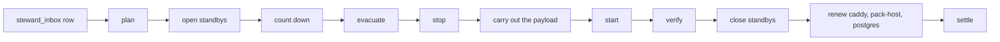

# steward-agent

`steward-agent` holds the Docker socket, reads and writes the server volumes and carries out every
run. It carries `compose.yml` inside its own image, so a change to the deployment is a new image of this
service. The same image runs as the `migrate` service, the only process that runs Flyway's `migrate`.
`migrate` creates every role, applies the schema and exits, and every service with a database login
waits for it. `steward` mounts no socket and calls `steward-agent` through `AgentClient` of
`:internal-api`. `:architecture` refuses `java.net.UnixDomainSocketAddress` in every class outside
steward-agent.

```bash
steward-agent up                          # Pulls the images, starts the services, waits for them and exits with the deployment's code (the setup script).
steward-agent serve                       # Serves the API, then carries out runs (the default in the container).
steward-agent migrate                     # Creates the roles, applies the schema and exits (the migrate service).
steward-agent run ID                      # Carries out the run handed to it, then exits (the one-shot).
steward-agent request KIND [a,b] [MIN]    # Writes the row a button writes and prints its id.
steward-agent status ID                   # Prints the run's status, a tab and its report.
```

`serve` serves the API, installs every empty slot, reports ready and then claims runs from
`steward_inbox`. The Minecraft services wait until `serve` is healthy. On the host, `request` and
`status` run through `docker exec <project>-steward-agent-1`; `request` writes the row that a button
writes, and `status` reads it.

## Refusals

- **Recreating itself:** `steward-agent` refuses its own name wherever a service name is accepted, and a
  one-shot recreates it.
- **Running another release:** `serve` hands an update to a newer release to a one-shot of that release.
- **Starting dependencies:** every `up` carries `--no-deps`, so it starts only the named services.
- **Scheduling:** a run starts only from a row in `steward_inbox`, written by a button, `/update`, a
  clock in `steward` or `steward-agent request`. The sampler runs on its own clock and only reads.
- **Handing out secrets:** no route carries a container's environment or the env file.

## Runs



Every kind of run follows the sequence in `Run`, and `Kinds` holds one planner per kind. A plan that
stops no service starts no countdown. `StewardRequest` types the payload of a request.

| kind            | payload                                                                                                                                                                                   |
| --------------- | ----------------------------------------------------------------------------------------------------------------------------------------------------------------------------------------- |
| `UPDATE`        | resolve what is newer, stage it, migrate, move the jars, recreate moved images, prune unused ones                                                                                         |
| `RESTART`       | restart the named services, install nothing                                                                                                                                               |
| `BACKUP`        | refused when the disk lacks room, else dump and tar the backup set, then copy the newest archives offsite                                                                                 |
| `DOWN`, `START` | stop a service and hold it down, release a hold                                                                                                                                           |
| `RECREATE`      | recreate the named containers from the images on this host; `DEPLOY` pulls first                                                                                                          |
| `RESTORE`       | take a fresh backup, then restore one archive; a dump replaces `public` in one transaction, then `migrate` runs; a volume that fails after it was emptied keeps its servers down and held |
| `REMOVE_PLUGIN` | stop one server, delete the plugin's jar and data folder, start it                                                                                                                        |

A run recreates caddy, pack-host and postgres last, and only in a run that counts down. It does so
after the standbys have handed their players back and stopped, because caddy carries their ports.

A run's report consists of messages of the admin bundle (`report.*` in `ReportTexts` of `:database`).
Every line detail and every change, except an installed version, is a message reference with typed
values. Steward's run page and the bot's update feed render each reference for the reader, and
`status ID` prints it in English.

A note records the step it is about, its outcome (done, skipped, warning or failed), the service it
concerns and a short message. A note about several services is stored as one record per service.
Steward's run page shows every record and filters them by outcome and service. The bot's card shows
only the failed records, and only for a run that failed or was stopped. A subsystem's answer (a Docker
or `pg_dump` error, a source's response) is a value of the message that names it, or of `report.words`.

### Runs of another release

`serve` carries out only the runs of its own release. It hands an update to a newer release, or an
update that finds the agent's own container out of date, to a one-shot:

1. `serve` writes `<project>-steward-agent-run` into the `runner` column of the row. The row stays
   `RUNNING` and is the lock.
2. `serve` pulls `steward-agent` at that release, copies `compose.yml` out of that image and starts the
   one-shot from it with `compose run --rm`.
3. The one-shot (`steward-agent run ID`) plans again, counts down, stops what changes, runs `migrate`,
   installs, starts and verifies.
4. Last, the one-shot recreates the long-running agent at its release, waits until the agent is
   healthy and settles the row.

From the hand-over until the row is settled, the agent serves state, logs, the console and the plan,
and claims no request. A row whose one-shot is gone without settling it fails at the next wake-up. The
agent refuses an older release. The one-shot copies its output into `steward-backups/runs/<id>.log`
and keeps the newest ten. Archive listing and retention read only the files that lie directly in the
backups folder.

## Version sources

| what                                                 | source                                                                                                                       |
| ---------------------------------------------------- | ---------------------------------------------------------------------------------------------------------------------------- |
| the season-2 jars, the resource pack and its `.sha1` | GitHub releases of `nordtal/season-2`, read through `/releases/latest`; a jar is checked against its asset's sha256 `digest` |
| PacketEvents                                         | Modrinth v2, filtered to the Minecraft version and `paper`                                                                   |
| Paper, Velocity                                      | PaperMC Fill v3, newest `STABLE` build                                                                                       |
| what is installed                                    | the volumes under `volumes-root`                                                                                             |
| the pack the proxy offers                            | the proxy's `pack` settings, `url` and `sha1`                                                                                |

## Rules

- `serve` acts only on rows in its inbox and never runs `migrate`. Its one other task is drawing item
  icons. When `mojang-assets` is on and a server exports a Minecraft version without icons, `serve`
  fetches that client jar, checks its sha1, draws every item at 32 pixels into one sheet in
  `game_assets` and deletes the jar. An advancement whose icon carries banner patterns gets a slot under
  its own id. A sheet records the painter that drew it, a hash of the drawing classes, and `serve` draws
  the sheet again when the running painter differs. `serve` keeps no file of Mojang's.
- Before every `up`, recreate and start of a service whose `user:` is a uid, the agent hands the
  service's mounts to that uid (`Compose#handOver`). It does so in a throwaway container of the
  service's own image, started with `--pull never`, so the agent reads nothing of the volume, and it
  leaves a volume alone that already belongs to the uid. After a run stops a standby, the agent hands
  the standby's mounts over again, because the install mirrors the service's plugins into them as root
  during the run.
- An update stops the services whose jars or containers change, runs `migrate`, installs, starts the
  services and waits until they are healthy. `bootstrap` fills empty slots and restarts nothing. It
  writes what it installed, or could not check, as an already settled run of kind `INSTALL`. Steward
  shows that run like any other, and the bot posts it only when it failed. `GET /api/plan` reports the plan and writes nothing.
- Advisory locks allow only one steward process to serve or move jars at a time.
- A run stages artefacts in `.nordtal-staging` inside the server's volume and moves them only when all
  are present. It deletes only what it accounts for, and only after the new jar is in place.
- A run notes every file it moves into place in `plugin_file` with the agent's release, and Steward's
  plugins tab names the release that installed a jar from that record.
- A version not tagged for the platform is refused. A run reports "Skipped" as a state of its own,
  distinct from success and failure.
- A deployment pulls every image before it stops anything. It tolerates a failed pull only when the
  image is already on the host.

## Contract

`AgentWire` holds the paths and records, and `AgentClient` is the client, both in `:internal-api`.
`{service}` is a compose service name.

| Route                                             | Answer                                                                                                 |
| ------------------------------------------------- | ------------------------------------------------------------------------------------------------------ |
| `GET /api/health`                                 | the only route that needs no token                                                                     |
| `GET /api/topology`                               | `Topology`: every service in the `compose.yml` of the image, its image and the meaning of its labels   |
| `GET /api/containers`                             | `Containers`: every container of the project with the sampler's last `Reading`                         |
| `GET /api/containers/{service}`                   | one `Container`, with the registry digests of its image; `404` when the service has no container       |
| `GET /api/images`                                 | `ImageResult`: each running image compared with its registry; the route is slow                        |
| `GET /api/containers/{service}/logs`              | SSE: `line` and `run` events with the backlog first, then `end` or `gone` when the stream stops        |
| `GET /api/containers/{service}/log-capacity?max=` | `LogCapacity`: how many lines the backlog can hold                                                     |
| `POST /api/containers/{service}/console`          | accepts a `ConsoleLine` (`command`, `actor`) and answers `202`; the server's answer appears in the log |
| `GET /api/host`                                   | `Host`: `/proc`, the root filesystem and Docker's disk use                                             |
| `GET /api/volumes/{service}/disk`                 | `Disk`: `du` of that service's volume; `404` for one not mounted here                                  |
| `GET /api/bundles`                                | `BundleRef`s: every editable message bundle that a jar carries, without opening the bundle             |
| `GET /api/bundles/{service}?module=`              | one `MessageBundle`, the packaged texts and layouts                                                    |
| `GET /api/descriptors`                            | `Descriptor`s: the descriptor of each jar of ours, one per id                                          |
| `GET /api/samples?after=`                         | the sampler's `Round`s after an ISO instant, oldest first                                              |
| `GET /api/backups`                                | `Archive`s, newest first                                                                               |
| `GET /api/backups/{name}`                         | one finished archive's bytes; `400` for a name that is not one, `404` when it is gone                  |
| `GET /api/plan`                                   | what the next update would change, resolved at request time; changes nothing                           |
| `GET /api/plugins/{service}`                      | the managed plugins of one server                                                                      |
| `GET /api/plugins/{service}/search?q=`            | Modrinth's search result for that server's platform                                                    |
| `POST /api/plugins/{service}?by=`                 | adds a plugin to the list that the next run installs; a `REMOVE_PLUGIN` run removes one                |

Every route except `/api/health` needs the header `X-Steward-Token`, and the service refuses to start
without a token. `InternalServer` of `:internal-api` checks the header, and `steward-bunq` uses the same
class. A refusal is a `Refusal` (`error`, the sentence to show, `where`). The service answers `502`
with `where` set to `docker` or `compose` when the daemon or a Compose command failed, and `400`
with `where` set to `steward-agent` for a request it will not run. `steward` passes `where` through.

A descriptor is the `nordtal-plugin.json` that the `nordtal.plugin-descriptor` convention writes into
every jar of ours. It holds the id that the jar's settings are published under, the custom editor per
group, and whether the process follows the message overrides (`followsMessages`).
The agent finds a plugin's jar beside its data under `/configs/<service>`, and the jar of any other
service in its image. It reads the message bundles from the same jars, and only from the jars whose
process follows the overrides.

**Networks:** `steward` reaches the agent on the internal `agent` network. The agent reaches postgres
on the `agent-database` network and GitHub, Modrinth and PaperMC on the `agent-egress` network, which
no other service joins.

**Console:** the services that accept console input are the ones with the label
`eu.nordtal.console: "true"`, which the agent reads through `docker compose config`. The agent passes a
line to `mc` as one argument and never through a shell, and the log names the person who typed it by
the `Actor` that the wire carries. The row of an added plugin holds the same actor as `actor_kind` and
`actor_id`, taken from the session and never from the browser.

**Backup set and stop set:** the backup set is the agent's own mounts under `/backup-sources`, and the
stop set is the services with the label `eu.nordtal.backup: stop`. `/api/topology` serves both, and
`steward` keeps no list of either.

**Labels:** the labels drive the servers and the network page, and nothing in Java or TypeScript mirrors them.

| label                   | on                               | value                                                                                          |
| ----------------------- | -------------------------------- | ---------------------------------------------------------------------------------------------- |
| `eu.nordtal.server`     | the four Minecraft servers       | `paper` or `velocity`; the service has a plugins folder                                        |
| `eu.nordtal.plugins`    | the same                         | `artifact[=jar prefix][?]` per plugin, with `?` where the jar may be missing                   |
| `eu.nordtal.standby-of` | `proxy-standby`, `limbo-standby` | the service it stands in for, whose `plugins/` folder the standby receives a copy of           |
| `eu.nordtal.renew`      | every service a run makes again  | `run` (stopped, renewed, started), `after` (renewed once the rest is back) or `last`           |
| `eu.nordtal.section`    | every service Steward draws      | the heading under which the network page groups the service; a service without it is not drawn |
| `eu.nordtal.entry`      | `proxy`, `caddy`                 | `true`: players reach the service from outside                                                 |
| `eu.nordtal.reaches`    | `proxy`, `steward`, `caddy`      | the services it sends requests to, separated by spaces                                         |
| `eu.nordtal.stores-in`  | every service with a login       | the services it keeps its data in, separated by spaces                                         |

The entrypoint reads `eu.nordtal.server` and `eu.nordtal.plugins` as `SERVER_KIND` and
`SERVER_PLUGINS`, which are YAML aliases of the labels, so the guard and the agent read one string.
The sampler reads `docker stats` and `/proc` every 30 seconds and keeps the last hour. `steward` copies
new rounds into `metric_sample` and asks only for rounds after the newest one it holds.

## Settings

The database connection comes from the environment (`NORDTAL_STEWARD_AGENT_DATABASE_*`, with one
`..._<ROLE>_PASSWORD` per service role that the agent creates before it migrates). Everything a run
reads is in the `runs` settings group in the database, which Steward edits: release sources, volumes
root, timeouts, backup retention and how long a backup waits for a server to stop.

| Setting (`NORDTAL_STEWARD_AGENT_*`) | Default                | Meaning                                                                            |
| ----------------------------------- | ---------------------- | ---------------------------------------------------------------------------------- |
| `TOKEN`                             | none, required         | the secret that `steward` sends                                                    |
| `PORT`                              | `8081`                 | the port the API listens on                                                        |
| `DOCKER_SOCKET`                     | `/var/run/docker.sock` | the path of the Docker daemon's socket                                             |
| `CONFIGS`                           | `/configs`             | each server's plugins folder, whose jars carry the descriptors and message bundles |
| `VOLUMES_ROOT`                      | `/volumes`             | the `volumes-root` of the `runs` group: the volumes that a run installs into       |
| `BACKUP_SOURCES`                    | `/backup-sources`      | one mount per volume that a backup saves and a restore writes back                 |
| `BACKUPS`                           | `/backups`             | the archives, in the same volume that postgres dumps into                          |

## Building and testing

```bash
./gradlew :steward-agent:test           # Uses no network; the fixtures in src/test/resources/fixtures/ are recorded API answers.
./gradlew :steward-agent:imageContext   # Stages the jar and compose.yml into build/image/.
docker build -f deploy/jvm/Dockerfile --build-arg MODULE=steward-agent -t ghcr.io/nordtal/steward-agent:dev .
```

`TopologyTest` reads the repository's real `compose.yml`.

## Code layout

- `Compose` builds every `docker compose` command line, for this service and for `dev`, so the local
  stack and the deployment call Compose the same way. `:architecture` allows `dev` to use nothing else
  of this module.
- `StewardAgent` holds the entry points, and `HostRequests` implements `request` and `status`.
- `run` holds the inbox loop (`UpdateServer`, `Runner`), the sequence (`Run`, `Choreography`,
  `UpdateRun`) and the kinds (`Kinds`). `LocalStack` and `LocalSnapshots` are the containers and
  archives that a run acts on.
- `plan`, `apply`, `source` and `plugin` resolve what is current, place it, read where versions come
  from and manage the plugins. `schema` holds the migration and the roles.
- `gamedata` draws the icons (`MojangClient`, `IconPainter`, `IconSheet`, `GameAssets`).
- `AgentApi` composes every other route in one place: `docker`, `logs`, `measure`, `backup` and `topology`.
- `FakeDaemon` is a test fixture: a socket that answers like Docker. `AgentStandIn` serves this API over
  it, and the tests of `steward` talk to it through the real client.
