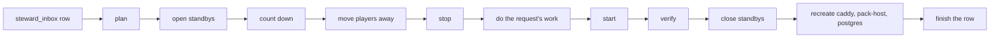

# steward-agent

`steward-agent` holds the Docker socket and the volumes. It starts, stops and updates the other
services, and it carries out every run. Its image contains `compose.yml`.

The same image is the `migrate` service. `migrate` is the only process that runs Flyway's `migrate`:
it creates every role, applies the schema and exits. Every service with a database login waits for it.

`steward` mounts no Docker socket and calls the agent through `AgentClient` in `:internal-api`.
`:architecture` refuses `java.net.UnixDomainSocketAddress` in every other module.

## Commands

```bash
# Pull every image, start the stack and wait until it is healthy. The exit code tells the result.
steward-agent up
# Serve the API and carry out runs. This is the container's default.
steward-agent serve
# Create the roles, apply the schema and exit.
steward-agent migrate
# Carry out the run with this id and exit.
steward-agent run ID
# Write a run request, as a button does, and print its id.
steward-agent request KIND [a,b] [MIN]
# Print the status and stage of a run, then each step with its facts.
steward-agent status ID
```

`request` and `status` write and read a row of `steward_inbox`. The host calls them with
`docker exec <project>-steward-agent-1`.

## What the agent refuses

- `steward-agent` never recreates itself. A temporary container recreates it.
- The agent never runs a release other than its own. For an update to a newer release, it starts a
  temporary container from that release's image (see "Updating to another release").
- Every `up` carries `--no-deps`, so the agent never starts a dependency by itself.
- The agent starts a run only for a row of `steward_inbox`. Only the sampler runs on its own clock,
  and it only reads `docker stats` and `/proc`.
- No route returns a container's environment or the env file.

## Runs



A standby is a service that stands in for another one, such as `proxy-standby`. Every kind of run
follows this sequence. `Run` implements it, `Kinds` holds one planner per kind, and
`StewardRequest` types the request's data.

The agent recreates caddy, pack-host and postgres last, after the standbys have stopped. Caddy
publishes the standbys' ports.

A run is its rows: `run_step` with an outcome and a reason code per step, and a fact table per kind
of fact, with the archives in `backup_archive`. Steward's run page and `status` draw a run from those
rows, and `RunLines` in `:database` words the facts of a step for both. The bot's card draws the
same rows: one line per service, marked by the worst outcome of its steps, and the reason of each
step that failed or warned.

## Updating to another release

`serve` runs only runs of its own release. For an update to a newer release, it starts a temporary
container of that release. It does the same when the agent's own container is out of date. The steps
are:

1. `serve` writes `<project>-steward-agent-run` into the `runner` column of the row. The row keeps
   the status `RUNNING` and works as the lock.
2. `serve` pulls `steward-agent` at that release and copies `compose.yml` out of the image.
3. `serve` starts the temporary container from that `compose.yml` with `compose run --rm`.
4. The container (`steward-agent run ID`) plans again, counts down, stops what changes, runs
   `migrate`, installs, starts and verifies.
5. The container writes no run rows before `migrate` has applied its newest migration, since the
   tables of those rows may not exist before. It writes the run's stage and services from the
   start, and its log names how each step before `migrate` ended.
6. The container recreates the long-running agent at the new release and waits until it is healthy.
7. The container finishes the row.

Between step 1 and step 7, the agent serves state, logs, the console and the plan, and it starts no
other run. If the container is gone and the row is unfinished, the next wake-up marks the row failed.
The agent refuses an older release.

The container writes its output to `steward-backups/runs/<id>.log` and keeps the newest ten logs.

## Sources of versions

| what                                                 | source                                                         |
| ---------------------------------------------------- | -------------------------------------------------------------- |
| the season-2 jars, the resource pack and its `.sha1` | `/releases/latest` of the GitHub repository `nordtal/season-2` |
| PacketEvents                                         | Modrinth v2, filtered by the Minecraft version and `paper`     |
| Paper and Velocity                                   | PaperMC Fill v3, the newest `STABLE` build                     |
| what is installed                                    | the volumes under `volumes-root`                               |
| the resource pack the proxy offers                   | the `url` and `sha1` of the proxy's `pack` settings            |

The agent checks every jar against the sha256 `digest` of its release asset.

## Guarantees

- `serve` acts only on rows of its inbox and never migrates.
- An update stops the services whose jars or containers change, runs `migrate`, installs the new
  files, starts the services and waits until they are healthy.
- A run stages artefacts in `.nordtal-staging` in the server's volume. It moves them only when all
  are present.
- A deployment pulls every image before it stops anything. It tolerates a failed pull only when the
  image is already on the host.
- The agent refuses a version that is not tagged for the platform.
- Two steward processes cannot serve or move jars at the same time, because of advisory locks.

## API

`AgentWire` in `:internal-api` holds the paths and records, and `AgentClient` is the client. Every
route except `GET /api/health` needs the header `X-Steward-Token`. The agent refuses to start without
`NORDTAL_STEWARD_AGENT_TOKEN`.

A failed request returns a `Refusal`. Status `502` means that Docker or Compose failed, and status
`400` means that the agent will not run the request.

The labels in `compose.yml` control the servers and the network page. No Java or TypeScript code
mirrors them.

## Build and test

```bash
# Run the tests. They use no network, and their fixtures are recorded API answers.
./gradlew :steward-agent:test
# Copy the jar and compose.yml into build/image/.
./gradlew :steward-agent:imageContext
# Build the image.
docker build -f deploy/jvm/Dockerfile --build-arg MODULE=steward-agent -t ghcr.io/nordtal/steward-agent:dev .
```

`FakeDaemon` answers like Docker. `AgentStandIn` serves this API on top of it for the tests of
`steward`.
