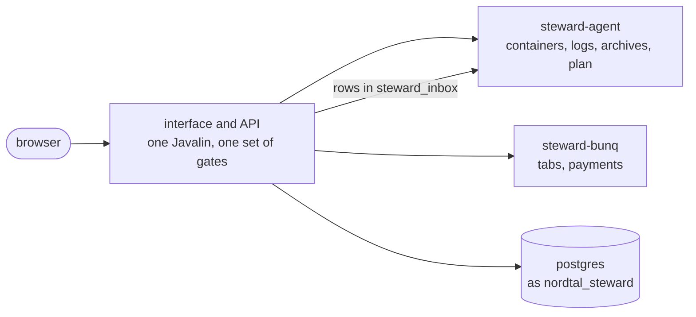

# steward

Steward serves the web interface and its API, payments, metrics, alerts and the clocks that request
runs. It carries out no run itself. A button, a clock or `/update` writes a row into `steward_inbox`,
and `steward-agent` carries it out. Steward starts after `steward-agent` is healthy, so the schema is
current.

```bash
docker compose up -d steward                                           # Serve the interface.
docker exec nordtal-s2-steward-1 steward forget-factors <discord-id>   # Remove the second factors of one admin.
docker run --rm ghcr.io/nordtal/steward generate-vapid-keys            # Print a Web Push keypair.
```

Steward refuses any other argument.



## One process

The interface, the stack routes (`stack/Routes`) and the view of runs share one Javalin and one set of
gates.

- A read or an easily undone change needs a signed-in admin with a second factor in this session
  (`KEY_HELD`).
- A destructive or irreversible change, a grant of access or money, and a change of admins or keys need
  a valid step-up (`KEY_FRESH`).
- `GateTest` names the gate of every change. `Updates.needsStepUp` sets the step-up per kind of run.
- A second factor is a security key (WebAuthn) or an authenticator app (`auth/Totp`, RFC 6238: SHA-1,
  six digits, 30 seconds, one step either side, each step once).
- `web.totp-key` seals the app's secret. Without it Steward does not offer the app.
- Adding a factor needs a step-up. Steward refuses to remove the last factor.
- A step-up holds 15 minutes, or 1 or 6 hours when its sheet asks for that (`SecondFactor.StepUpLength`).
  `steward_session.step_up_until` stores its end, and `DELETE /api/step-up` ends it early.

Steward holds no Docker socket and mounts no volume. It reaches Docker through `steward-agent` with
`AgentClient`. It logs in as `nordtal_steward` (`DatabaseRole.STEWARD`), and its tests use that role, so
a statement without a grant fails in `check`.

## What it does

- **Runs:** The agent writes each report into the `steward_inbox` row, and the interface follows it on
  `nordtal_update`.
- **Containers and images:** The agent supplies state, health and the last sample. A console suggests
  commands from the `command_tree` of its server. An image whose registry did not answer shows as
  unchecked.
- **Metrics:** Every 30 seconds Steward copies the agent's new sampler rounds into `metric_sample`.
  After 30 days it folds them into hourly means.
- **Backups:** The nightly clock writes a request row. Steward lists and downloads archives through the
  agent.
- **Journal:** Every changing route has a `Gate` and one journal decision. `Journaled.as(action)` makes
  `journal.Journaling` write the lines the handler named after the route answered below 400. `Unjournaled`
  names why a route writes no line. `JournaledRoutesTest` fails on a changing route with neither.
- **Alerts:** Steward measures the stack every 30 seconds against the thresholds of the `web` group. It
  downloads the proxy's pack URL every ten minutes. It raises failed runs and unbookable payments. The bot
  raises what it could not do in Discord. Steward sends each `admin_alert` row once per alert type and
  admin to Web Push and to the admin channel through the bot's inbox.
- **Payments:** Steward holds no bank credential. `Bookings` in `:database` books a payment in one
  transaction: it marks the request paid, appends the access, sets the donor flag, writes the journal line
  and tells the bot. The poll books a matched payment at the `prices` read at start. Every question to
  bunq goes to `steward-bunq`. At start Steward asks it for the account for up to thirty seconds. If it
  does not answer, Steward logs ERROR and keeps payments off until the next start.

### The live stream

A signed-in browser holds one `GET /api/live` (`KEY_HELD`), an SSE stream of `change` events with the data
`{topic, version}`: a `live.Topic` and a short hash of its new answer. The browser fetches again from the
route that owns the topic.

- `LiveFeed` reads a topic with the reads those routes use and announces it when the hash changes. It
  reads only while a browser listens.
- The hub triggers it on the channels in `Web.LIVE_CHANNELS` and every minute. `nordtal_smp` is not a
  channel.
- Steward reads the topics only the agent knows (containers, host, topology) every ten seconds.
- Logs have their own follow, which Steward relays from the agent.

### The API's types

Every route reads and answers records declared in its feature package.

- `./gradlew :steward:generateApiTypes` writes `frontend/src/lib/api.gen.ts` from them. `ApiTypesTest`
  fails `check` when the committed file differs.
- `ApiTypes`, `StewardWire` and `ApiRoots` (test sources) reflect over the records and list the roots.
- A `@Nullable` component is an absent field, never `null`.
- `WireJson` is the one codec of the routes.
- `lib/api.ts` holds three hand-written types: the bodies of a settings save and a message save (`null`
  resets, absent leaves) and the glyph manifest.

### Texts

Every word the page shows is a key of the English-only `steward` bundle, declared by `texts.StewardTexts`.
Admins can override it like any other text.

- `GET /api/texts` serves the variants of every key as parsed trees with the overrides applied. It needs
  no sign-in.
- `lib/texts.ts` fills a tree into text nodes, never markup.
- `generateApiTypes` writes `texts.gen.ts` and `texts.gen.json`. `TextTypesTest` fails when either
  differs.
- A refusal shown to a person is a `texts.RequestRefused` with a status, a message of the bundle and a
  code the page branches on. A refused write of `:database` (`Refused`) reaches the same handlers.
- Steward answers a malformed request with a literal.
- `texts.Forms` holds the words of every settings dialog. A server's own answer passes through
  `steward.said.words`.

### Game data, pickers, editors

- `GET /api/game-data` serves the union of the servers' catalogues for the newest version with the index
  of the icon sheet. Steward caches the sheet per version.
- The settings form draws a picker for each field whose schema sets `refers`. If nothing can be listed,
  the form shows the typed field.
- Channels come from the list discord-bot publishes into `guild_channels`. Steward holds no bot token and
  shows the last list while the bot is down.
- A plugin's descriptor may name a custom editor per group. The registry draws it only when the editor
  reads the document it received. An editor knows its structure, never a label or a reference.

### Plugin config files

The text config files of the plugins that are not Nordtal's stay files on the server's volume.
steward-agent lists, reads and writes them (`plan.PluginFiles`); `/api/services/{name}/plugin-file`
forwards the asker.

- A request reaches only a file the listing found. A path from the request is never joined.
- A save writes the whole text and refuses with 409 when the file changed since its revision. It
  restarts nothing; the server reads the file when it next starts. The journal records it as a settings
  save.

### The Translations page

`/translations` edits every text of every bundle, Steward's own included, from `GET /api/messages`.

- A service shows a text its jar ships where it draws one of the text's places (`TextServices`): the bot
  in Discord, Steward on its page, every other service in the game. A building block stays with every
  service that ships it.
- A bundle that ships English only is edited in English only.
- The styled view edits runs of text with values as pills (`lib/rich-text.ts`). The source view colours
  the source with the one parser in `lib/message-tree.ts`.
- `MessageCheck` alone decides whether a text is right. The editor calls `GET /api/message-check` when
  typing pauses, and the save refuses what it errs on.
- `GET /api/message-fallbacks` lists overrides no process shows.
- A preview draws a plural or a choice as the case the example of its value picks. It uses `other` if
  the example names none.
- The counter shows the `limit` of the key, the strictest of its places.
- The send button of a place calls `POST /api/message-preview`. A Discord place arrives as a direct
  message from the bot. A game place arrives on the server of the admin's linked player.
- `PUT /api/messages` saves the changes of every bundle, keyed by bundle and key.

### Documents

`GET /api/documents` answers each packaged document, a Discord message or a game text, (`messages.DocumentsApi`) with its
declaration, the services that ship it, its hash and the admin's document. The admin's document is
carried over to the jar's declaration, and `adapted` lists what that changed. The answer also holds the
network's languages, and each document says whether a release changed the packaged document after the
admin saved. The Translations page shows each document as a preview and opens its editor in its card.
A game text's lines are edited in the key editor's field (`message-editor/rich-field.tsx`), with the
game's tones, glyphs and values; it adds only text blocks and offers no Discord line style.
`PUT /api/documents/{namespace}/{name}` saves the admin's document against the packaged hash and
refuses one that `DocumentCheck` refuses; the bot follows the change and edits its managed messages
at once. Each save is kept as a version with its admin and time: `GET /api/documents/{namespace}/{name}/versions`
answers them newest first, each carried over to the jar's declaration, and the editor restores one by saving it again.
`DELETE /api/documents/{namespace}/{name}` makes the packaged document live again and is kept as a version too.
A shared part is a part an admin saved under a name (`shared_part`); a document holds a copy of it, marked
with its name. `POST /api/shared-parts/{name}/changes` answers each saved document that holds a copy,
before and after, with what the check refuses. `PUT /api/shared-parts/{name}` stores the part and
rewrites every copy in one transaction, each rewrite kept as a version, and refuses all of it if the
check refuses one document. `DELETE` removes the shared part and leaves its copies as plain parts.
`POST /api/documents/render` draws a draft, every value at its declared example, and answers
what a save would be refused for. A Discord document is drawn with the bot's own renderer from
`discord-rendering` as Discord's JSON, which the preview only draws, with the count of components. A
menu is drawn with the game's `GameDocument` as its title, then each item's name and lore and each
label, in MiniMessage. A chat text, a tab list, a kick screen, a title, a boss bar and a server list are drawn with
`GameDocument` as their lines in MiniMessage; a title's first line is the title and the lines after it
its subtitle.
`POST /api/document-preview` sends a draft of a message or a plain document to the admin alone: the bot
draws it with the same renderer, every value at its example, and sends it as a direct message. A game
text's draft goes to the game server of the admin's linked player, which shows it where its shape is.
It refuses a modal, a channel name and a draft a save would refuse.
`GET /api/discord/channels` answers the live channels.

`POST /api/document-images` stores a PNG, JPEG, GIF or WebP image of at most 8 MiB, and
`GET /api/document-images/{id}` serves it; a document shows it as `upload://<id>`.

## Configuration

The environment supplies the connection and every secret. Three groups in the database hold everything
else. Steward publishes them at start, and its settings pages edit them. `StewardSettings` checks them
before the web starts. A change to `steward` rearms both clocks without a restart. A change to `alerts`
applies at the next reading.

| group      | environment                  | holds                                                                                          |
| ---------- | ---------------------------- | ---------------------------------------------------------------------------------------------- |
| `steward`  | `NORDTAL_STEWARD_*`          | the clocks, the agent's and steward-bunq's addresses                                           |
| `web`      | `NORDTAL_STEWARD_WEB_*`      | the port, the public address, Discord sign-in, WebAuthn, Web Push, the authenticator app's key |
| `alerts`   | `NORDTAL_STEWARD_ALERTS_*`   | the thresholds steward's measured alerts fire on                                               |
| `database` | `NORDTAL_STEWARD_DATABASE_*` | the connection, from the environment alone                                                     |

## Tests

```bash
./gradlew :steward:test       # Run without network. Stack tests talk to AgentStandIn, the agent's API over a fake daemon.
./gradlew :steward:preview    # Serve the real interface on http://localhost:18180 over stand-ins and a scratch database.
```

`preview` signs in as an invented admin whose key counts as just held. `--args="--dump FILE"` first
restores a `pg_dump`. Preview writes the session cookie to `build/preview/state.json` as Playwright's
`storageState`. The stand-in agent has no bundle of its own, so the Translations page lists nothing until
`--jars DIR` supplies real jars, one directory per service (`DIR/smp/smp-<version>.jar`,
`DIR/discord-bot/discord-bot-<version>.jar`).
